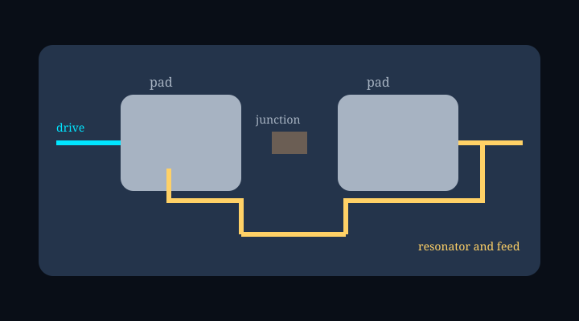

# What a transmon qubit is, and what one shot can prove

A transmon qubit is easy to cartoon and easy to misread. The package, the arrow on a sphere, and the dot on an I\u2013Q plot get treated as one object. They are three. This is a field guide for people who can already read a circuit, and who want the drawing to stay honest.

You can watch the split happen in a [34-second schematic](https://mizcausevic-dev.github.io/transmon-anatomy/). The source sits in the [transmon-anatomy repository](https://github.com/mizcausevic-dev/transmon-anatomy). Nothing on that page is a measured device. The value is the discipline of the picture.

## Start with the package on the cold stage

The object on the bench is a chip in a package, on a cold stage, at millikelvin temperature. Two metal electrodes sit on a substrate. One Josephson junction joins them.

A drive line comes in through a capacitive gap. A readout resonator couples through another gap, and a feedline carries the probe in and out.

That is the hardware. It is a representative package. It is not a fabrication layout. No pad length, no barrier thickness, and no resonance in gigahertz appears, because none of those numbers was measured for this drawing.

Cooling puts the circuit in a quiet electrical environment. Cooling is not initialization. The ideal story begins only when we declare an initial state, `|0\u27e9`, and say we mean the ground state of the computational subspace.

The lid of the package fades so you can see the chip. The device is still operated enclosed. The fade is a reveal, rather than a lab instruction.

## The junction is a barrier, and the barrier stays intact

A Josephson junction is two superconducting films with a thin insulating barrier between them. Brian Josephson showed in 1962 that Cooper pairs can tunnel coherently through that barrier, and that the tunneling depends on the superconducting phase difference across it ([Josephson, Physics Letters 1, 251](https://doi.org/10.1016/0031-9163(62)91369-0)).

Call that phase difference \u03c6. It is a junction variable. It lives on the junction, and it is a different object from a coordinate on the Bloch sphere. The barrier in this schematic stays whole. There is no classical particle in the drawing, and the insulator is unbroken.

Zoom in and the scale change is labeled. The violet band on the barrier is a drawing of coherent pair tunneling. It is an overlay on the metal, drawn larger than any micrograph this page owns.

The same rule covers the cyan mark in the drive gap and the gold marks in the readout gaps. Color is a signal. Metal is metal.

## A shunt is what makes this a transmon qubit

The early charge qubit, the Cooper pair box, could be parked at a sweet spot where first-order charge noise dropped out. Vion and coauthors showed that move in 2002, and coherence improved ([Vion et al., Science 296, 886](https://doi.org/10.1126/science.1069372)). Charge noise was still the design problem.

Koch, Blais, Girvin, Schoelkopf, and their coauthors answered it in 2007 by adding a large shunt capacitance and running at a high ratio of Josephson energy to charging energy, `EJ/EC`. Charge dispersion then falls exponentially with that ratio. Anharmonicity falls only as a weak power of the same ratio. They named the result a transmon ([Koch et al., Phys. Rev. A 76, 042319](https://doi.org/10.1103/PhysRevA.76.042319)).

Read that trade in plain language. The shunt makes the transition frequency stubborn against offset charge. The cost is a ladder of levels that is only mildly uneven. The gap from `|1\u27e9` to `|2\u27e9` is smaller than the gap from `|0\u27e9` to `|1\u27e9`, so a drive can favor the lower transition, and higher rungs are still there.

Krantz and coauthors later wrote the engineer\u2019s map of this family, including the fixed-frequency devices that have no flux knob ([Krantz et al., Applied Physics Reviews 6, 021318](https://doi.org/10.1063/1.5089550)).

This schematic is that fixed-frequency case. One junction. No SQUID loop. No flux-bias line. Frequency is set when the junction and the shunt are made.

The ladder on screen is qualitative: a shorter second rung, a fainter `|2\u27e9`, and no claim about hertz. The computational subspace is `|0\u27e9` and `|1\u27e9`. Higher levels remain. Selective control is a design aim. It is short of immunity to leakage, and it is short of a measured gate fidelity.

| Layer | What you are seeing | What you may conclude |
| --- | --- | --- |
| Hardware | Package, pads, one junction, drive, resonator, feed | A representative circuit, not a layout or a spectrum |
| Overlay | Cyan drive, gold probe, violet tunneling band | A signal mark, not extra metal or a particle |
| Math | Envelope, angle \u03b8, Bloch vector, ideal state | A declared control model, not live tracking |
| Synthetic data | Two clouds, one dot, one assignment | One seeded record, not a fidelity |

## Lock the Bloch sphere before you animate it

A control picture is a convention plus a Hamiltonian. Change either one and the arrow walks somewhere else. This explainer picks a convention and keeps it.

`|0\u27e9` is north, on `+Z`. `|1\u27e9` is south, on `\u2212Z`. A positive microwave envelope rotates the state about `+X`.

In the rotating frame the drive is `H(t) = \u210f \u03a9(t) \u03c3x / 2`. The angle is the integral of the rate, `\u03b8(t) = \u222b \u03a9(\u03c4) d\u03c4`. From `|0\u27e9`, the ideal state is `cos(\u03b8/2)|0\u27e9 \u2212 i sin(\u03b8/2)|1\u27e9`.

The envelope on screen is a raised cosine, drawn slow so you can see it. The area is fixed: `\u03b8` ends at `\u03c0/2`. The final ideal state is `(|0\u27e9 \u2212 i|1\u27e9)/\u221a2`.

The arrow starts on `+Z` and ends on `\u2212Y`. Both basis probabilities are one half. The relative phase is still `\u2212i`. Equal probabilities leave that phase in place.

Other labs hang the drive on `\u03c3y`, or they track a different global phase. Those are legitimate notebooks. They are not this notebook. For example, a quarter-turn about `+Y` would finish on a different equator point. If a figure will not say which axis it used, do not trust the final arrow.

The ribbon along the drive line is the envelope, stretched in time. It is not a march of photons, and the drawn speed is not a propagation delay. Leakage and decoherence are omitted on purpose. The caption says so. The omission is the scope line of an ideal two-level model, not a claim that the chip is that model.

## Dispersive readout does not hand you the wavefunction

Readout here is circuit quantum electrodynamics in the dispersive regime. The qubit and the resonator sit off resonance. The resonator\u2019s response then depends on the qubit state.

Blais, Wallraff, Girvin, Schoelkopf, and coauthors set that architecture out in 2004 ([Blais et al., Phys. Rev. A 69, 062320](https://doi.org/10.1103/PhysRevA.69.062320)). In the two-level sketch, the resonator frequency shifts by an amount of order `g\u00b2/\u0394`, with the sign set by the state. Higher levels of a transmon correct the shift. Koch and coauthors already had to account for that correction.

What leaves the chip is a microwave on the feedline. The honest next drawing is a chain of stages. Amplification happens off the chip, at staged temperatures. Demodulation and integration happen at room temperature. The explainer names those stages and leaves the amplifier\u2019s interior blank.

A superposition is not a deterministic halfway tone. If the prepared state is an even split of `|0\u27e9` and `|1\u27e9`, a single probe does not come back with the average amplitude and the average phase of the two clouds. You may show the two mean responses as labeled alternatives. You may not paint their average and call it this shot.

The incoming probe in the schematic is generic. The outgoing probe is not. Its amplitude and phase are taken from one integrated record, the same record that will land as the dot. That match is the point of the animation. Pause on it.

## One shot is one integrated record

A useful readout trace is demodulated and integrated. The result is one point in the I\u2013Q plane, in arbitrary units. That point is the whole integrated record, rather than the resonator field at one instant.

Walter and coauthors showed how a record of that kind supports rapid single-shot assignment ([Walter et al., Phys. Rev. Applied 7, 054020](https://doi.org/10.1103/PhysRevApplied.7.054020)). Their fidelity belongs to their device. This page does not borrow it.

The clouds are repeated preparations. Prepare `|0\u27e9` many times, record a point each time, and you get one blob. Prepare `|1\u27e9` many times and you get the other. The blobs are references. They are not simultaneous readings of one circuit, and they are not the prepared state of the shot you are about to classify.

Overlap is the honest part. A linear boundary, the perpendicular bisector of the two cloud centers, assigns the point. Points from a reference cloud can fall on the wrong side. The assignment is a report about the record. It is not a promise that the report matches the state you meant to prepare.

The basis sample in this model is created when the shot is drawn. The prepared probabilities are one half and one half. A random draw picks a basis outcome, then noise picks a point from that outcome\u2019s cloud.

The sample is a simulator variable. It comes into existence with the shot. The page keeps it out of the main caption. After the assignment appears, a closed note can compare the two numbers. That comparison is unavailable from the record alone.

For instance, the fixed seed in this project produced one point near `I = \u22120.624` and `Q = \u22120.216`, and the boundary reported assignment 0. The simulator\u2019s basis sample was also 0. Nearby cloud points still cross the line. Agreement on one seed is not a fidelity, and replaying the page will not draw a new experiment. The seed is part of the model, the way a figure\u2019s random number is part of a methods section.

The sphere leaves before that dot. From the moment the assignment is on screen, the Bloch picture is gone, or it would have to be relabeled as a prepared-state model rather than live tracking. You cannot watch `\u03b8` and the classification as if they were one instrument.

## The blanks are the claim

A schematic earns trust by what it refuses. This one refuses a SQUID, a flux line, a barrier drawn as a broken window, and a photon drawn as a marble. It refuses device dimensions, transition frequencies, coherence times, and gate fidelities. It refuses to treat the lid fade as an operating procedure. It refuses to treat the cold stage as a reset button.

The control math is calculated. The final angle is `\u03c0/2` because the envelope area was specified. A fitted pulse did not produce it. The readout cloud is calculated from a seeded Gaussian model. The chip outline is a drawing.

Those three sentences are the whole epistemology of the page. Mix them and the genre changes. A device paper, a textbook derivation, and a product claim are different jobs. This page is a schematic with a clock.

If you want a number the page does not show, the correct caption is that the number is absent. Specifically, \u201cnot measured\u201d and \u201cnot calculated\u201d are different absences. The angle was calculated. The junction width was not. A reader who wants a frequency has to go to a device paper, such as the Koch analysis or a later review, and then remember that those numbers are not this picture.

## Watch it in order, then pause on the last shot

The page runs 34 seconds, on a clock that does not follow the frame rate. Five shots cover the package, the junction, the ladder, the drive, and the readout. Play, pause, replay, and the timeline all seek that same clock.

Audio starts on the click, because a browser will not start sound uninvited. The score is original and synthetic. It is presentation music. It is separate from the microwave, and separate from the quantum state.

The checks that lock the convention are in the [control model](../src/model/control.ts). The seeded record is in the [readout model](../src/model/measurement.ts).

Reduced motion snaps the camera and drops the decorative carrier. If WebGL fails, the diagrams and a flat layout remain. The evidence line stays on screen the whole time: a scientific schematic, idealized control, synthetic readout.

Which phase convention did the drawing pick? Positive envelope, rotation about `+X`, finish on `\u2212Y`. Does the outgoing tone match the dot? It should, because both read the same record. Is the sphere still up when the assignment appears? It should be gone.

The next step is to open the transmon qubit schematic, press play, and stop on the readout shot. Check the three questions before you trust a cleaner animation that answers them by accident.
